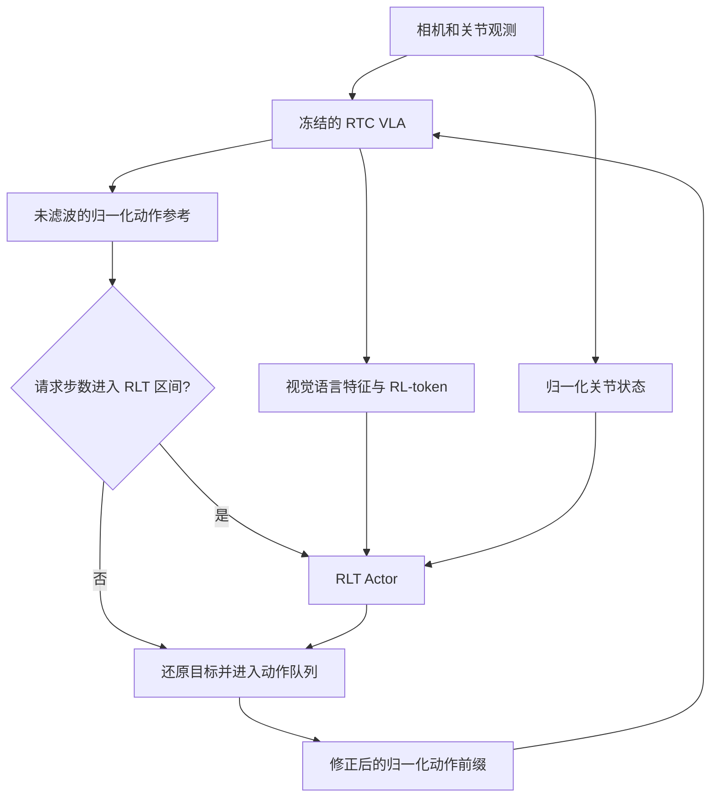

# RTC 接入 Evo-RLT 工作文档

本流程使用现有 InferenceTimeRTC PI0.5 作为冻结的 VLA，在指定步数区间内将 RTC VLA 的未滤波动作块直接交给 RLT，再把结果送入天钡动作队列。S-G 与 RLT 互斥：普通 RTC 保留 S-G，开启 RLT 会话后绕过滤波。你需要完成两端代码更新、带区间和结果标签的数据准备、离线训练和部署验证；不需要重新训练 VLA。

示例沿用插卡任务、50 步动作块和 30 FPS，服务地址为 `10.61.5.1:8110`。整钞任务应同时更换模型、任务文本和训练数据，并单独训练对应的 RLT 头。当前使用 `1123_rlt` 分支，包含 RLT 区间版及统一 30 FPS 的代码与指南；实际部署前仍需按第 4 节同步到运行的服务器和天钡，并核对两端版本与命令。

日常执行请优先使用 [操作指南](操作指南.md) §1.10.7–§1.10.9：其中包含交互密码上传、按采集名称独立保存首轮产物、后续累计数据继续训练及退回旧 Actor/普通 RTC 的完整流程。本工作文档保留原理和固定训练目录示例，两种目录方式选定一种后应连续使用；新版逐轮流程从上一轮 Actor 同目录读取数据清单。首批 50 回合、后续每批 20–30 回合是试验安排，不是论文规定的数据量。

## 1 理解计算流程



Actor 的动作参考直接来自 RTC VLA 的输出，同时还接收 RL-token 表征和关节状态。RLT 头学习任务相关的动作改进，开启时不执行 S-G；普通 RTC 的 S-G 平滑路径继续保留。

这里有两种“前缀”，需要分清：

| 名称 | 内容 | 用途 |
| --- | --- | --- |
| RTC 动作前缀 | 上一块尚未执行的动作目标 | 引导下一块与现有计划衔接 |
| VLA 视觉语言前缀特征 | 同一次 VLA 前向产生的最终隐藏状态 | 交给 RL-token 编码器提取状态表征 |

RLT 开启时，服务器执行 VLA 和 RLT，天钡负责采集观测、上传 PNG、动作出队、机械臂下发、人工接管和 PKL 录制。VLA 与 RLT 使用天钡命令指定的服务器 GPU，两端都不对 RLT 路径执行 S-G。`rlt.enabled=true` 会自动把 S-G 窗口设为 0，兼容仍带 `--action_sg_window=7` 的旧命令；本流程的 RLT 命令仍显式设置为 0，避免混淆。

普通 RTC 中的 S-G 只平滑关节位置，保留夹爪通道。RLT 路径不做 S-G，Actor 预测整个动作向量，因此可以改变关节和夹爪目标。Actor 输出为绝对归一化目标，裁剪到 `[-1,1]` 后还原为物理目标；它不是对关节角叠加一个固定幅度的残差。

## 2 查看实现入口

以下路径均相对于本仓库根目录。代码已经接好，可从这些入口理解和扩展。

| 文件 | 主要职责 |
| --- | --- |
| [modeling_pi05.py](src/lerobot/policies/pi05/modeling_pi05.py) | `predict_action_chunk_with_features()` 返回同一次前向的动作、最终视觉语言特征和有效掩码，避免额外跑一次视觉模型 |
| [policy_server.py](src/lerobot/inference_time_rtc/policy_server.py) | 握手选择模型和 GPU，加载 RLT；`_predict_vla()` 保留原 RTC 采样路径 |
| [runtime.py](src/lerobot/inference_time_rtc/rlt/runtime.py) | `prepare_reference()` 获取未滤波 VLA 参考及原统计坐标；`predict_chunk()` 调用 Actor 并回写前缀 |
| [networks.py](src/lerobot/inference_time_rtc/rlt/networks.py) | RL-token、Actor、Twin-Q、前缀保护、权重保存和加载 |
| [cache.py](src/lerobot/inference_time_rtc/rlt/cache.py) | 从转换后的数据集构建训练缓存，复用部署的未滤波 RTC VLA 流程 |
| [training.py](src/lerobot/inference_time_rtc/rlt/training.py) | 先训练 token 重建，再训练 Actor/Critic |
| [configs.py](src/lerobot/inference_time_rtc/configs.py) | 客户端 `rlt.enabled`、`rlt.checkpoint`、`rlt.start_step`、`rlt.end_step` 配置 |
| [action_buffer.py](src/lerobot/inference_time_rtc/action_buffer.py) | 识别 `rlt_applied`，避免重复过滤，保存用于续推的归一化目标 |
| [rollout.py](src/lerobot/inference_time_rtc/rollout.py) | 接入已有人工接管和 PKL 录制流程 |

普通续推中，Actor 保留前 `min(剩余前缀长度, execution_horizon)` 行 RTC VLA 参考，可修改的其余行还必须落在 RLT 区间内。当前 horizon=20、chunk=50 时，通常只有后 30 行中位于区间内的行可修改。首块无动作前缀，区间仍然生效；当前姿态恢复时保护 `recovery.prefix_steps` 行，默认 6 行。

保护区保留的是经过 RTC 引导的 VLA 输出，不再执行 S-G；它不是把上一块动作硬拷贝到新块。RLT 修正后的归一化目标会成为下一次 RTC 前缀，避免继续引导到不再执行的旧 VLA 计划。

采集时按 `r` 标记需要学习片段的起止，按 `i` 仍进入已有人工接管流程，再按一次交回策略。`r` 只写训练标注，不临时切换部署中的 Actor。推理必须在命令中同时给出 `rlt.start_step` 和 `rlt.end_step`，服务器按区间逐行启用 Actor，区间外保留 RTC VLA 输出；目前没有自动识别关键阶段的模型。

## 3 固定实验配置

先按这一组参数跑通流程，再考虑改参数。训练与部署必须使用相同的配置。

| 项目 | 本例设置 |
| --- | --- |
| 本地仓库 | `E:\ABYT\a0810\Evo-RL-data-InferenceTimeRTC` |
| 天钡地址与仓库 | `10.61.5.108`，`/home/apex/code/Evo-RL-data-InferenceTimeRTC` |
| 服务器地址与仓库 | `10.61.5.1`，`/home/baiyuntian/baiyuntian/Evo-RL-data-InferenceTimeRTC` |
| 服务器 SSH | 用户 `baiyuntian`，端口 `2222` |
| 模型 | `Remove1112_1_7_pi05/checkpoints/last/pretrained_model` |
| 控制与保存频率 | 30 FPS；三路相机同为 30 FPS |
| 动作块长度 | 50 步；双臂动作宽度从模型和数据自动读取 |
| S-G | 普通 RTC：7 帧二阶；RLT：0，绕过滤波 |
| RTC | horizon=20，delay=16，queue=30，guidance=10，EXP，auto_delay=false |
| 部署区间 | `[100,250)` 仅为参数占位例；必须按采集标注估计实际步数 |
| 观测传输 | lossless_png，压缩级别 1 |
| GPU | 部署由天钡选择 `cuda:0`；示例离线编码和训练用 `cuda:1` |

模型路径、processor 统计、动作和状态名称顺序、相机配置、FPS、有效 S-G 窗口和 RTC 参数都会影响训练与部署是否匹配。RLT 的窗口固定为 0。本区间版 head 格式为 v2；旧版 S-G 参考产物和无区间掩码的 v1 cache/head 都不能直接复用，必须用带区间标注的数据重新编码并完成 token、AC 训练。本例使用 `*_phase_raw_v2` 文件名区分旧产物，下一轮实验使用 `*_phase_raw_v3`，文件名轮号不等于权重格式号。

已有真实执行数据必须同时具备经过核对的逐帧区间标注，才能重新生成未滤波参考；没有区间标注时应重新采集或先完成逐帧补标，本工具没有一键推断区间的命令。仅有成功标签不足以用于本流程。当前统一使用真实 30 FPS 数据，不再按 25 FPS 采集或训练。已确认服务器 `Remove1112_1`～`Remove1112_7` 合计 209 回合，均为 30 FPS，可在核对并补齐区间标注后使用；已有其他频率的数据不能仅修改 FPS 元数据混入。缓存命令不会自动重采样。

若已生成 25 FPS 的缓存或 RLT 权重，需要按 30 FPS 重新构建缓存并训练，不能直接改权重中的 FPS 合同。`training token` 和 `training ac` 从缓存读取频率，无需另加 FPS 参数。当前 50 步动作块约 1.667 秒，horizon=20 约 0.667 秒，delay=16 约 0.533 秒，queue=30 约 1 秒；本次不自动重调这些步数参数。

## 4 更新两端源码

先正常结束正在运行的客户端、录制和 8110 服务，再更新文件。服务器和天钡都必须更新；新服务的 Ready 握手必须包含 `rtc-rlt-direct-vla=1` 和 `rtc-rlt-step-interval=1`，旧的“RLT 接在 S-G 后”或无步数区间的服务不可混用。下面只同步源码与文档，不包含数据集、模型、运行日志或编译缓存。

### 在 Windows 打包当前工作目录

在 PowerShell 执行。此方法会包含尚未提交的新 RLT 文件。

```powershell
Set-Location E:\ABYT\a0810\Evo-RL-data-InferenceTimeRTC
$OutputEncoding = [System.Text.UTF8Encoding]::new($false)
$env:PYTHONUTF8 = '1'
$rltBundle = Join-Path $env:TEMP 'rtc_rlt_source_20261123.zip'
@'
from pathlib import Path
from zipfile import ZipFile, ZIP_DEFLATED
import sys

root = Path.cwd()
entries = [
    root / "src",
    root / "tests" / "inference_time_rtc",
    root / "pyproject.toml",
    root / "LICENSE",
    root / "convert_pkl_dataset.py",
    root / "resumable_conversion.py",
    root / "resumable_upload.py",
    root / "resume_common.py",
    root / "resume_assembly.py",
    root / "操作指南.md",
    root / "RTC接入Evo-RLT工作文档.md",
]
with ZipFile(sys.argv[1], "w", compression=ZIP_DEFLATED, compresslevel=1) as archive:
    for entry in entries:
        candidates = entry.rglob("*") if entry.is_dir() else [entry]
        for path in candidates:
            if path.is_file() and "__pycache__" not in path.parts and path.suffix != ".pyc":
                archive.write(path, path.relative_to(root).as_posix())
print(sys.argv[1])
'@ | python - "$rltBundle"

scp -i "$env:USERPROFILE\.ssh\id_ed25519_trae_10_61_5_1" -P 2222 "$rltBundle" baiyuntian@10.61.5.1:/tmp/rtc_rlt_source.zip
scp "$rltBundle" apex@10.61.5.108:/tmp/rtc_rlt_source.zip
```

### 在服务器备份并解压

```bash
source /nfs/zxlong10/anaconda3/etc/profile.d/conda.sh
conda activate /nfs/zxlong10/anaconda3/envs/evo-rl
cd /home/baiyuntian/baiyuntian/Evo-RL-data-InferenceTimeRTC
rlt_backup="$HOME/.local/share/lerobot/backups/rtc_rlt_$(date +%Y%m%d_%H%M%S)"
mkdir -p "$rlt_backup"
tar -czf "$rlt_backup/source_before_rlt.tgz" src pyproject.toml 操作指南.md convert_pkl_dataset.py resumable_conversion.py resumable_upload.py resume_common.py resume_assembly.py
python -m zipfile -e /tmp/rtc_rlt_source.zip "$PWD"
export PYTHONPATH="$PWD/src${PYTHONPATH:+:$PYTHONPATH}"
python -c "from lerobot.inference_time_rtc.rlt.networks import RLTHeadBundle; print('RLT imports OK')"
```

### 在天钡备份并解压

```bash
source /home/apex/anaconda3/etc/profile.d/conda.sh
conda activate /home/apex/anaconda3/envs/evo-rl
cd /home/apex/code/Evo-RL-data-InferenceTimeRTC
rlt_backup="$HOME/.local/share/lerobot/backups/rtc_rlt_$(date +%Y%m%d_%H%M%S)"
mkdir -p "$rlt_backup"
tar -czf "$rlt_backup/source_before_rlt.tgz" src pyproject.toml 操作指南.md convert_pkl_dataset.py resumable_conversion.py resumable_upload.py resume_common.py resume_assembly.py
python -m zipfile -e /tmp/rtc_rlt_source.zip "$PWD"
export PYTHONPATH="$PWD/src${PYTHONPATH:+:$PYTHONPATH}"
python -c "from lerobot.inference_time_rtc.configs import RTCRLTConfig; print(RTCRLTConfig())"
```

这些步骤不启动机械臂。直接使用原环境，不需要安装上游 Evo-RLT 包或升级 Python/LeRobot。

## 5 启动 8110 并准备天钡采集命令

### 服务器终端

复制下面整段并保持终端运行。服务端不指定 GPU，由天钡握手选择。服务器既可接受普通 RTC 客户端，也可接受带 RLT 的客户端，一个服务同一时间由一个客户端使用。

```bash
source /nfs/zxlong10/anaconda3/etc/profile.d/conda.sh
conda activate /nfs/zxlong10/anaconda3/envs/evo-rl
cd /home/baiyuntian/baiyuntian/Evo-RL-data-InferenceTimeRTC
export PYTHONPATH="$PWD/src${PYTHONPATH:+:$PYTHONPATH}"
export HF_HUB_OFFLINE=1 TRANSFORMERS_OFFLINE=1

rtc_cache=/home/baiyuntian/.cache/lerobot/rtc-gpu0-prefix-bench-srjzqsij/max-autotune
export TORCHINDUCTOR_CACHE_DIR="$rtc_cache/inductor"
export TRITON_CACHE_DIR="$rtc_cache/triton"
export TORCHINDUCTOR_FX_GRAPH_CACHE=1 TORCHINDUCTOR_AUTOGRAD_CACHE=1
export TORCHINDUCTOR_COMPILE_THREADS=12 OMP_NUM_THREADS=8

python -m lerobot.inference_time_rtc.policy_server \
  --host=0.0.0.0 \
  --port=8110 \
  --policy_type=pi05 \
  --checkpoint_root=/nfs/lerobot/piper/models/evo/policy \
  --policy_dtype=bfloat16 \
  --compile_model=true \
  --compile_mode=max-autotune \
  --warmup_on_connect=true \
  --warmup_task='Remove the card from the slot and insert it into the card reader.'
```

看到监听 8110 后可以启动客户端。模型选择与预热在客户端握手期间完成，随后才连接机械臂；无需另开进程再执行 `compile_warmup`。

### 天钡终端

先保存下面的公共启动脚本。保存脚本只定义环境和命令，不启动机械臂。之后普通 RTC 和 RLT 共用相机、CAN 和 PNG 参数；S-G 默认 7 帧供普通 RTC 使用，RLT 调用时通过 `RTC_ACTION_SG_WINDOW=0` 显式关闭。

```bash
mkdir -p /home/apex/.config/lerobot
cat > /home/apex/.config/lerobot/rtc_rlt_client.sh <<'BASH'
source /home/apex/anaconda3/etc/profile.d/conda.sh
conda activate /home/apex/anaconda3/envs/evo-rl
cd /home/apex/code/Evo-RL-data-InferenceTimeRTC
export PYTHONPATH="$PWD/src${PYTHONPATH:+:$PYTHONPATH}"
export no_grpc_proxy=10.61.5.1,127.0.0.1,localhost
export no_proxy=10.61.5.1,127.0.0.1,localhost

rtc_model=/nfs/lerobot/piper/models/evo/policy/Remove1112_1_7_pi05/checkpoints/last/pretrained_model
rtc_task='Remove the card from the slot and insert it into the card reader.'
rlt_head=/nfs/lerobot/piper/models/evo/policy/rtc_rlt_Remove1112_1_7/actor_phase_raw_v2.pt

run_rtc_rollout() {
  rtc_run="${1:?请提供本次采集名称}"
  shift
  rtc_capture="/home/apex/.cache/huggingface/lerobot/piper/$rtc_run"
  rtc_dataset="${rtc_capture}-dataset"
  python -m lerobot.inference_time_rtc.rollout \
    --server_address=10.61.5.1:8110 \
    --policy_type=pi05 \
    --pretrained_name_or_path="$rtc_model" \
    --policy_device=cuda:0 \
    --rpc_timeout_s=1800 \
    --allow_late_splice=false \
    --actions_per_chunk=50 \
    --action_sg_window="${RTC_ACTION_SG_WINDOW:-7}" \
    --robot.type=bi_piper_follower \
    --robot.left_arm_config.port=can3 \
    --robot.right_arm_config.port=can2 \
    --robot.id=my_bi_piper_follower \
    --robot.left_arm_config.require_calibration=false \
    --robot.right_arm_config.require_calibration=false \
    --robot.left_arm_config.cameras="{fixed: {type: intelrealsense, serial_number_or_name: '263122074897', width: 640, height: 480, fps: 30}, wrist: {type: intelrealsense, serial_number_or_name: '263122072536', width: 640, height: 480, fps: 30}}" \
    --robot.right_arm_config.cameras="{wrist: {type: intelrealsense, serial_number_or_name: '262722075213', width: 640, height: 480, fps: 30}}" \
    --teleop.type=bi_piper_leader \
    --teleop.left_arm_config.port=can1 \
    --teleop.right_arm_config.port=can0 \
    --teleop.id=my_bi_piper_leader \
    --teleop.left_arm_config.require_calibration=false \
    --teleop.right_arm_config.require_calibration=false \
    --display_data=false \
    --play_sounds=false \
    --dataset.repo_id="piper/$rtc_run" \
    --dataset.root="$rtc_capture" \
    --dataset.single_task="$rtc_task" \
    --dataset.fps=30 \
    --dataset.num_episodes="${RTC_EPISODES:-50}" \
    --dataset.episode_time_s=240 \
    --dataset.reset_time_s=60 \
    --dataset.storage=pkl \
    --dataset.push_to_hub=false \
    --rtc.enabled=true \
    --rtc.execution_horizon=20 \
    --rtc.max_guidance_weight=10.0 \
    --rtc.prefix_attention_schedule=EXP \
    --rtc.queue_threshold=30 \
    --rtc.auto_delay=false \
    --rtc.inference_delay=16 \
    --rtc.observation_image_codec=lossless_png \
    --rtc.latency_window=20 \
    --recovery.enabled=true \
    "$@"
}
BASH
source /home/apex/.config/lerobot/rtc_rlt_client.sh
```

## 6 采集第零轮数据并上传

如果已有同任务、同配置、带明确成功失败标签及逐帧 RLT 区间标注的 30 FPS 数据，可直接使用。旧数据缺少 `rlt_phase/rlt_phase_id` 时不能直接进入缓存训练。否则在天钡执行下面的启动命令。这一步会连接并控制机械臂；普通 RTC 仍使用 7 帧 S-G，RLT 此时关闭。

```bash
source /home/apex/.config/lerobot/rtc_rlt_client.sh
run_rtc_rollout "Remove_rtc_base_$(date +%Y%m%d_%H%M%S)" --rlt.enabled=false
```

每个 episode 开始时标注关闭。到需要 RLT 学习的片段起点按 `r`，终点再按 `r`，可以标记多个片段；每次新片段的 `phase_id` 递增，区间外为 -1。未再次按 `r` 的片段持续到 episode 结束，下个 episode 自动归零、关闭。每个计划用于缓存的 episode 至少标注一段；完全没标注的 episode 会使缓存构建报错，而不是默认训练全任务。

默认按键可用 `--rlt_phase_toggle_key=b` 更换，不能与人工接管和结果按键冲突；连续切换有 0.5 秒防连发间隔，复位阶段不接收标记。原有 LeRobot 数据集若缺少这些字段，普通模式仍可 `--resume=true` 继续录制，但会禁用区间标记并提示创建新数据；不会给旧帧补造标注。PKL capture 沿用新建目录流程，不支持 resume。

`r` 仅标注，不改变当前动作控制；`i` 切入人工接管，再按一次交回策略。用 `s` 标记成功、`f` 标记失败。自然到时或使用默认结束方式的回合会按 `failure` 保存，缓存不会把它识别为缺标签；真实成功时必须按 `s`。人工介入救回的轨迹可以用于训练，但评估时要单独统计无人接管成功率。`Esc` 沿用原 rollout 的收尾与复位行为，不是硬件急停。

逐帧记录三个独立字段：`complementary_info.rlt_phase` 是标注开关，`complementary_info.rlt_phase_id` 是分段编号，`complementary_info.rlt_applied` 表示本行是否由 Actor 直接替换。普通 RTC 采集时可以存在标注段，但 `rlt_applied` 全为 false；不要把“标了关键段”误读成“已经启用 RLT”。

录制正常退出后，在同一天钡终端继续执行。变量 `rtc_run`、`rtc_capture`、`rtc_dataset` 由上面的函数保留；新终端需要先把 `rtc_run` 设置成实际采集名称，再据此设置两个目录。

```bash
python convert_pkl_dataset.py --input "$rtc_capture/capture.pkl" --validate-only

python convert_pkl_dataset.py \
  --input "$rtc_capture/capture.pkl" \
  --output "$rtc_dataset" \
  --no-upload

python convert_pkl_dataset.py \
  --upload-only \
  --output "$rtc_dataset" \
  --upload-target "baiyuntian@10.61.5.1:/nfs/lerobot/piper/datasets/$rtc_run" \
  --upload-port=2222

printf '服务器数据目录：/nfs/lerobot/piper/datasets/%s\n数据 repo_id：piper/%s\n' "$rtc_run" "$rtc_run"
```

记下打印的服务器目录与 repo_id。后续训练读取的是转换后数据集的 `meta/`、`data/` 和 `videos/`，不直接读取原始 `capture.pkl`。

## 7 在服务器建立训练目录和缓存

### 保存服务器工作环境

在服务器另开终端，保存并加载工作环境。训练卡示例使用 GPU 1，避免占用部署示例的 GPU 0；按实际空闲情况修改。

```bash
mkdir -p /home/baiyuntian/.config/lerobot
cat > /home/baiyuntian/.config/lerobot/rtc_rlt_server.sh <<'BASH'
source /nfs/zxlong10/anaconda3/etc/profile.d/conda.sh
conda activate /nfs/zxlong10/anaconda3/envs/evo-rl
cd /home/baiyuntian/baiyuntian/Evo-RL-data-InferenceTimeRTC
export PYTHONPATH="$PWD/src${PYTHONPATH:+:$PYTHONPATH}"
export HF_HUB_OFFLINE=1 TRANSFORMERS_OFFLINE=1
rtc_model=/nfs/lerobot/piper/models/evo/policy/Remove1112_1_7_pi05/checkpoints/last/pretrained_model
rtc_task='Remove the card from the slot and insert it into the card reader.'
rlt_root=/nfs/lerobot/piper/models/evo/policy/rtc_rlt_Remove1112_1_7
rlt_train_device=cuda:1
BASH
source /home/baiyuntian/.config/lerobot/rtc_rlt_server.sh
mkdir -p "$rlt_root"
```

`rlt_root` 必须在 8110 的 `checkpoint_root` 目录内，否则客户端选择 RLT 权重时会被拒绝。

### 指定实际训练数据

把下一段的 `rlt_run` 改为第 6 节实际打印的采集名称。占位名称不能直接用于训练。

```bash
rlt_run=Remove_rtc_base_YYYYMMDD_HHMMSS
rlt_dataset="/nfs/lerobot/piper/datasets/$rlt_run"
rlt_repo="piper/$rlt_run"

python - "$rlt_repo" "$rlt_dataset" "$rlt_root/datasets_phase_raw_v2.json" <<'PY'
import json
import sys
from pathlib import Path
repo_id, root, output = sys.argv[1:]
assert (Path(root) / "meta" / "info.json").is_file(), "请替换为实际转换后数据目录"
Path(output).write_text(json.dumps([
    {"repo_id": repo_id, "root": root, "source": "rollout"}
], ensure_ascii=False, indent=2), encoding="utf-8")
print(output)
PY
```

每个 episode 必须有明确的 `episode_success`，并包含有效的 `complementary_info.rlt_phase`、`complementary_info.rlt_phase_id`，且至少有一段标注。缺少任一条件会拒绝缓存；即使 `source` 填 `demo`，也不会默认全部成功或默认整段开启 RLT。可用 `"success_labels": "/绝对路径/labels.json"` 补充回合结果，例如 `{"0": "success", "1": "failure"}`；它不能代替逐帧区间标注。

### 只读查看采集片段的起止步数

在上述服务器终端执行。它只读取转换后的 Parquet 标注，不加载 VLA、8110 或机械臂。打印的步数按各 episode 的 `frame_index`，`end_step` 不包含该行；时间只是按 FPS 换算的名义采样时间，不包含额外等待。

```bash
python - "$rlt_dataset" <<'PY'
import json
import sys
from pathlib import Path
import pyarrow.parquet as pq

root = Path(sys.argv[1])
fps = float(json.loads((root / "meta/info.json").read_text(encoding="utf-8"))["fps"])
phase_key = "complementary_info.rlt_phase"
id_key = "complementary_info.rlt_phase_id"
columns = ["episode_index", "frame_index", phase_key, id_key]
segments = {}
episodes = set()

def scalar(value):
    if isinstance(value, list):
        assert len(value) == 1, "Expected one scalar label per frame"
        return value[0]
    return value

for path in sorted((root / "data").rglob("*.parquet")):
    parquet = pq.ParquetFile(path)
    assert not set(columns) - set(parquet.schema_arrow.names), f"Missing phase columns: {path}"
    for batch in parquet.iter_batches(columns=columns):
        for row in batch.to_pylist():
            episode = int(scalar(row["episode_index"]))
            frame = int(scalar(row["frame_index"]))
            active = bool(scalar(row[phase_key]))
            phase_id = int(scalar(row[id_key]))
            episodes.add(episode)
            if active:
                assert phase_id >= 0
                segments.setdefault((episode, phase_id), set()).add(frame)
            else:
                assert phase_id == -1

assert episodes, "No recorded frames found"
for episode in sorted(episodes):
    groups = sorted((key, frames) for key, frames in segments.items() if key[0] == episode)
    assert groups, f"Episode {episode} has no marked interval; cache will reject it"
    for (_, phase_id), frames in groups:
        start, end = min(frames), max(frames) + 1
        assert len(frames) == end - start, "A phase_id must identify one contiguous interval"
        print(f"episode={episode} phase_id={phase_id} start_step={start} end_step={end} "
              f"nominal_seconds=[{start/fps:.2f},{end/fps:.2f})")
PY
```

根据多回合结果及实际动作选择部署的 `[start_step,end_step)`，不要直接把某一回合的按键时刻当作通用任务阶段。可以标注多段供训练，但当前部署命令一次只配置一个连续区间；起止步数不写入模型归一化合同，不要求与每条采集标注逐值相同。

### 先用一个 episode 验证缓存构建

```bash
python -m lerobot.inference_time_rtc.rlt.cache \
  --base-model "$rtc_model" \
  --dataset-spec "$rlt_root/datasets_phase_raw_v2.json" \
  --output "$rlt_root/cache_smoke_phase_raw_v2.pt" \
  --device "$rlt_train_device" \
  --dtype bfloat16 \
  --task "$rtc_task" \
  --fps 30 \
  --chunk-size 50 \
  --sg-window 0 \
  --execution-horizon 20 \
  --inference-delay 16 \
  --queue-threshold 30 \
  --max-guidance-weight 10 \
  --prefix-attention-schedule EXP \
  --token-pool-size 64 \
  --max-episodes 1
```

成功后应看到 `Saved ... RLT transitions to ...cache_smoke_phase_raw_v2.pt`。它确认数据读取和模型前向可运行，不代表已经训练出 RLT。

### 再构建完整缓存

```bash
python -m lerobot.inference_time_rtc.rlt.cache \
  --base-model "$rtc_model" \
  --dataset-spec "$rlt_root/datasets_phase_raw_v2.json" \
  --output "$rlt_root/transitions_phase_raw_v2.pt" \
  --device "$rlt_train_device" \
  --dtype bfloat16 \
  --task "$rtc_task" \
  --fps 30 \
  --chunk-size 50 \
  --sg-window 0 \
  --execution-horizon 20 \
  --inference-delay 16 \
  --queue-threshold 30 \
  --max-guidance-weight 10 \
  --prefix-attention-schedule EXP \
  --token-pool-size 64
```

缓存没有追加或断点续建功能，输出文件已存在会报错。小跑缓存与完整缓存必须使用不同名字；重新构建时另取新名字。

参考动作由当前冻结 RTC VLA 直接生成，不执行 S-G。缓存保留全 episode 的 Critic 采样点，并加入每个标注段的起点及 TD 所需后继点，短区间不会因全局 stride 而遗漏。token 只学习标注内起点的特征，Actor 只更新相应标注内且未受前缀保护的有效行；区间外样本仍用于 Critic 与 TD 上下文，不能丢弃。

Critic 的动作目标来自完整动作块的真实下发目标，并按原 checkpoint 统计归一化。TD 后继、终止与成功奖励仍按完整 episode 计算，不把标注段的结束伪造为成功。成功 episode 在最后有效一步奖励 `1`，失败奖励 `0`。离线续推使用此前生成参考的剩余动作作为前缀，不拿未来实录动作冒充前缀；它也不重现实际网络延迟或队列恢复事件。

## 8 训练 token 和 Actor Critic

这两项只在服务器读数据和训练网络，不连接机械臂。下面的步数和学习率用于跑通首轮训练，效果仍要通过部署评估。

### 训练 RL-token

```bash
source /home/baiyuntian/.config/lerobot/rtc_rlt_server.sh
python -m lerobot.inference_time_rtc.rlt.training token \
  --cache "$rlt_root/transitions_phase_raw_v2.pt" \
  --output "$rlt_root/token_phase_raw_v2.pt" \
  --device "$rlt_train_device" \
  --steps 1000 \
  --batch-size 16 \
  --learning-rate 0.0001 \
  --log-every 100 \
  --save-every 500
```

token 仅使用标注区间内起点的视觉语言特征做重建，区间外 Critic 上下文不用于 token 重建。日志打印 `reconstruction_loss`，结束时的 `stage` 应为 `token`。该文件不能直接用于部署。

### 训练 Actor 和双 Critic

```bash
python -m lerobot.inference_time_rtc.rlt.training ac \
  --cache "$rlt_root/transitions_phase_raw_v2.pt" \
  --token-checkpoint "$rlt_root/token_phase_raw_v2.pt" \
  --output "$rlt_root/actor_phase_raw_v2.pt" \
  --device "$rlt_train_device" \
  --steps 10000 \
  --batch-size 32 \
  --actor-lr 0.0003 \
  --critic-lr 0.0003 \
  --gamma 0.99 \
  --beta 1.0 \
  --log-every 100 \
  --save-every 1000
```

token 编码器在这一步冻结。双 Critic 使用全 episode 上下文，学习真实执行动作与结果的关系；Actor 仅更新标注区间内有效且未被前缀保护的行，同时优化 Q 值和靠近未滤波 VLA 参考的约束。区间外 Actor 和目标 Actor 都保留 VLA 参考。`beta` 越大越倾向于接近参考，减小会放宽偏离；平方差按有效可修改行的动作维度求和，不能照搬逐维均值损失的 beta 尺度。

标注应覆盖需要优化的动作并留出衔接余量。当前 20 步前缀在 30 FPS 下约为 0.667 秒；若全部标注行都被前缀保护，AC 会明确报告没有可训练 Actor 行。应按任务扩大或重新选择标注片段，不要为了凑样本关闭前缀保护。短片段会被缓存采到，不代表一定存在未受保护的可训练行。

训练会实时打印 `critic_loss`、`actor_loss`、`bc_loss`，并定期原子保存同一个输出文件。结束时 `stage` 应为 `actor_critic`，`training_updates` 中 token、critic、actor 均应大于零。损失降低不能替代真实任务的成功率评估。

若训练时显存不足，可先减小 `--batch-size`；不要为解决训练显存直接改变部署的 chunk、FPS 或动作维度。当前 checkpoint 同时保存 token 编码器、训练用解码器、Actor 和 Critic，会占用额外显存。

## 9 不连接机械臂验证 RLT 权重

先用小跑缓存中的一条样本检查训练产物。该命令在 CPU 上加载 RLT 头，不加载 VLA，也不连接 8110 或机械臂。

```bash
source /home/baiyuntian/.config/lerobot/rtc_rlt_server.sh
python - "$rlt_root/cache_smoke_phase_raw_v2.pt" "$rlt_root/actor_phase_raw_v2.pt" <<'PY'
import sys
import torch
from lerobot.inference_time_rtc.rlt.networks import RLTHeadBundle

cache = torch.load(sys.argv[1], map_location="cpu", weights_only=True)
head = RLTHeadBundle.load(sys.argv[2], device="cpu", require_actor=True)
assert head.contract == cache["metadata"]["contract"], "head 与缓存配置不一致"
data = cache["tensors"]
with torch.inference_mode():
    output = head.predict_chunk(
        data["vla_tokens"][:1].float(),
        data["proprio"][:1].float(),
        data["reference_actions"][:1].float(),
        protected_steps=data["protected_steps"][:1],
        action_mask=data["rlt_action_mask"][:1],
    )
assert tuple(output.shape) == (1, head.config.chunk_size, head.config.action_dim)
assert torch.isfinite(output).all()
editable = data["rlt_action_mask"][:1] & (
    torch.arange(head.config.chunk_size)[None, :] >= data["protected_steps"][:1, None]
)
assert torch.equal(output[~editable], data["reference_actions"][:1].float()[~editable])
print("stage:", head.trained_stage)
print("updates:", head.training_updates)
print("output shape:", tuple(output.shape))
print("RLT head smoke test OK")
PY
```

预期为 `stage: actor_critic` 和完整的 `(1, 50, 动作维度)` 输出。第一行可能属于区间外 Critic 上下文，此时应完全保留 VLA；这也验证了区间掩码。此检查只验证文件、配置和前向计算；H200 上的时延、显存以及实机动作效果需要下一步评估。

`actor_phase_raw_v2.pt` 是 PyTorch 权重包，不是 TorchScript、AOT 或 `.pt2` 可执行产物。部署时原来的 VLA 仍按服务端 `torch.compile` 设置运行。返回视觉语言特征的编译分支需要单独预热，服务器会在启用 RLT 的握手中自动完成。

## 10 在天钡启用 RLT

确认第 9 节通过、8110 运行的是更新后的代码，再结束旧客户端。在天钡执行下面整段。这一步会连接并控制机械臂；先用少量 episode 检验新策略。启用 RLT 必须同时提供起止步数，采用 0 起算的半开区间 `[start_step,end_step)`。下例 `[100,250)` 在 30 FPS 下约对应第 3.33–8.33 秒，只是参数占位例，不是实测推荐，应按标注统计与真实动作替换。

```bash
source /home/apex/.config/lerobot/rtc_rlt_client.sh
rlt_head=/nfs/lerobot/piper/models/evo/policy/rtc_rlt_Remove1112_1_7/actor_phase_raw_v2.pt
RTC_EPISODES=5 RTC_ACTION_SG_WINDOW=0 run_rtc_rollout "Remove_rtc_rlt_phase_raw_v2_$(date +%Y%m%d_%H%M%S)" \
  --rlt.enabled=true \
  --rlt.start_step=100 \
  --rlt.end_step=250 \
  --rlt.checkpoint="$rlt_head"
```

`rlt_head` 是服务器可访问的绝对路径，天钡本地不需要复制模型文件。开关、权重、起止步数与 GPU 都由客户端提交。完整底层命令在第 5 节的函数内。本次调用把 `--action_sg_window` 设为 0，仍保留 `--rtc.observation_image_codec=lossless_png`。普通 RTC 不设置该环境变量时继续使用 7 帧 S-G；RLT 会话中即使位于配置区间外，S-G 也保持 0，不自动切回滤波。

rollout 的步数是每个 episode 实际写入数据集的逐帧索引，包含人工接管帧和保持帧；`i` 不会重置步数，新 episode 才从 0 开始。独立 `robot_client` 使用动作队列 timeline，跳过的 slots 计步，恢复暂停时冻结，两者不能直接按同一墙上时钟时间推断步数。服务器先检查请求锚点 `episode_step`：未到 start 或已到 end 时整块走 RTC VLA，不在 start 之前预计算未来 Actor。进入区间后，再根据 `episode_step+i` 与前缀保护生成逐行掩码，越过 end 的行保留 VLA。

跨入、跨出区间时，客户端会废弃旧阶段的在途回包，保留已有队列和 RTC 前缀，触发刷新请求而不等队列阈值，不主动清空队列。RPC、队列交接和前缀保护会造成近似过渡，Actor 实际开始可能晚于 start；它不是插帧器、姿态对齐或限幅器，不保证某一帧精确切换，也不保证 Actor 区间边缘没有跳变。区间外继续走带衔接前缀的 RTC VLA。

服务端先完成基础模型预热，再加载、校验 RLT 头，并预热返回特征的首块和续推路径。首次冷编译可能比旧的纯 RTC 握手更久；`rpc_timeout_s=1800` 给握手留时间，不会延长动作队列能支撑的时长。

服务器应出现：

```text
RLT loaded direct VLA
RLT feature-returning RTC warmup complete
RLT request=... protected_steps=... sg_window=0 total_pipeline_ms=... episode_step=... actor_rows=... interval=[100,250)
RLT bypass request=... episode_step=... interval=[100,250)
```

天钡日志在仓库 `logs/rtc_rollout_*.log` 中。`action_chunk` 中的 `rlt_reference_actions` 是未滤波的物理 VLA 参考，`processed_actions` 是最终输出；结合逐行的 `rlt_action_mask`、`episode_step`、`sent_action` 与数据的 `complementary_info.rlt_applied` 核对实际使用。`rlt_applied` 表示本次该行被 Actor 直接替换；false 的前缀保护行仍可能继承此前 Actor 生成的目标，不代表没有历史 RLT 影响。采集标注 `rlt_phase` 与实际使用标记不是同一件事。协议中的旧兼容字段 `sg_reference_actions` 为 `None`，新日志不再输出该键。

## 11 对照效果并继续下一轮

用相同的任务、初始摆放和 RTC 参数分别运行普通 RTC 与 RLT。按实际测试次数记录以下项目：

| 项目 | 普通 RTC 加 S-G | RTC 加 RLT（无 S-G） |
| --- | --- | --- |
| 测试 episode 数 | 待填写 | 待填写 |
| 无人工接管成功数 | 待填写 | 待填写 |
| 人工接管次数 | 待填写 | 待填写 |
| 队列耗尽与恢复次数 | 待填写 | 待填写 |
| 明显关节跳变或异常动作 | 待填写 | 待填写 |
| 稳态推理时延与显存 | 待测 | 待测 |

本地已有无硬件回归测试不能替代这里的 H200 与实机对照。RLT 增加了计算，也可能使动作偏离原 VLA；不要直接使用此前纯 RTC 的测速结果推断新流程的余量。

新 rollout 中仍按 `r` 标记片段，每回合至少一段，并用 `s/f` 标注结果。正常结束后按第 6 节转换并上传。在服务器的 `datasets_phase_raw_v3.json` 中同时保留本区间版旧数据和加入新数据；不要混入没有逐帧区间字段的旧采集。例如：

```json
[
  {"repo_id": "piper/实际第零轮名称", "root": "/nfs/lerobot/piper/datasets/实际第零轮名称", "source": "rollout"},
  {"repo_id": "piper/实际第一轮名称", "root": "/nfs/lerobot/piper/datasets/实际第一轮名称", "source": "rollout"}
]
```

按第 7 节完整缓存命令，将输入改为 `datasets_phase_raw_v3.json`，输出改为 `transitions_phase_raw_v3.pt`。训练命令只接受单个 `--cache` 文件，不能重复传入多个缓存来累计数据。

保持 token 表征不变，在同一服务器工作环境中继续训练权重：

```bash
source /home/baiyuntian/.config/lerobot/rtc_rlt_server.sh
python -m lerobot.inference_time_rtc.rlt.training ac \
  --cache "$rlt_root/transitions_phase_raw_v3.pt" \
  --token-checkpoint "$rlt_root/actor_phase_raw_v2.pt" \
  --output "$rlt_root/actor_phase_raw_v3.pt" \
  --device "$rlt_train_device" \
  --steps 5000 \
  --batch-size 32 \
  --actor-lr 0.0003 \
  --critic-lr 0.0003 \
  --gamma 0.99 \
  --beta 1.0 \
  --log-every 100 \
  --save-every 1000
```

这会继承权重并追加本次指定的更新次数，但重新建立 Adam 和 target critic，不是精确断点续训。token 子命令没有输入 checkpoint 的选项，每次都会新建 token 网络。通常在相同 VLA 和配置下，后续轮次只继续 AC，保留旧的 `actor_phase_raw_v2.pt` 便于对照和退回。

## 12 常见问题和退回普通 RTC

| 现象 | 处理 |
| --- | --- |
| 找不到 `lerobot.inference_time_rtc.rlt` | 检查两端是否同步了新增文件，并在仓库设置 `PYTHONPATH="$PWD/src..."` |
| `Restart the updated RTC server` | 8110 仍是旧进程，更新源码后正常重启该服务 |
| 缺少或无效的 `episode_success` | 补齐每回合明确结果，再重新构建缓存 |
| 缺少 `rlt_phase/rlt_phase_id` 或 episode 无标注段 | 使用区间版重新采集并按 `r` 标记，或完成核对后的逐帧补标；不能默认整段训练 |
| 旧 v1 head 或没有区间掩码的缓存 | 区间版使用 v2 权重格式，重新编码并训练 token、AC，勿只改文件名 |
| 缺少 `rlt.start_step/end_step` | 启用 RLT 时同时给出两个非负整数，且 end 大于 start；区间为 `[start,end)` |
| 没有有效且未受保护的 Actor 行 | 标注太短或全部落入前缀保护区；覆盖真实优化动作并留出衔接余量，勿取消保护来凑样本 |
| Dataset FPS 不匹配 | 使用真实匹配频率的数据；改命令里的 FPS 不能完成重采样 |
| cache 输出已存在 | 使用新文件名；当前没有缓存追加或续建 |
| `Checkpoint has no trained ...` | 检查部署文件是不是 `token_phase_raw_v2.pt`，或 AC 尚未产生有效保存 |
| `contract mismatch` | 对照模型、processor、动作/状态顺序、FPS、SG 和 RTC 参数；改变配置后需重新编码和训练 |
| RLT 文件不在 `checkpoint_root` 内 | 将输出放在本例的 `rlt_root` 中，或按需要调整服务端允许目录 |
| 首次握手耗时长 | 查看服务端编译和预热日志；区分握手编译耗时与稳态推理耗时 |
| 开启 RLT 后仍耗尽队列 | 对照 RPC 时间、服务器整段 pipeline 时间和队列日志；当前 `RLT total_pipeline_ms` 包含 VLA，不是纯 Actor 耗时。延长 `rpc_timeout_s` 不能增加队列余量 |

退回普通 RTC 时，先正常结束当前客户端，再在天钡执行：

```bash
source /home/apex/.config/lerobot/rtc_rlt_client.sh
run_rtc_rollout "Remove_rtc_baseline_$(date +%Y%m%d_%H%M%S)" --rlt.enabled=false
```

不设置 `RTC_ACTION_SG_WINDOW` 时，这会继续使用 PNG、7 帧 S-G 和原 RTC 流程，8110 可保持运行。如曾在终端中单独 export 该变量为 0，应先 `unset RTC_ACTION_SG_WINDOW`。若要退回源码版本，第 4 节在两台机器上分别生成了 `source_before_rlt.tgz` 备份；先正常结束相关进程，再按对应机器的备份恢复源码。

## 13 交付文件与完成条件

| 文件 | 内容 | 可直接用于部署 |
| --- | --- | --- |
| `datasets_phase_raw_v2.json` | 输入数据集清单 | 否 |
| `cache_smoke_phase_raw_v2.pt` | 小规模数据与模型前向验证产物 | 否 |
| `transitions_phase_raw_v2.pt` | 完整 token 与 AC 训练输入 | 否 |
| `token_phase_raw_v2.pt` | token 表征及训练记录 | 否 |
| `actor_phase_raw_v2.pt` | token 与 Actor/Critic 权重、训练配置和计数 | 是，需通过匹配检查 |
| 天钡 `capture.pkl` 及 episode 分片 | 实际执行、接管、区间标注、实际 RLT 使用与任务结果 | 用于后续转换与训练 |
| 两端 `logs/rtc_*.log` | RPC、动作块、实际下发目标和阶段耗时 | 用于诊断与对照 |

跑通流程以“有区间标注和结果标签的数据 → 完整缓存 → v2 格式训练后的 Actor → 无硬件加载通过 → 两端匹配握手与部署步数区间 → 新 rollout 可完整保存”为准。是否优于普通 RTC，以第 11 节的同条件对照结果判断。
